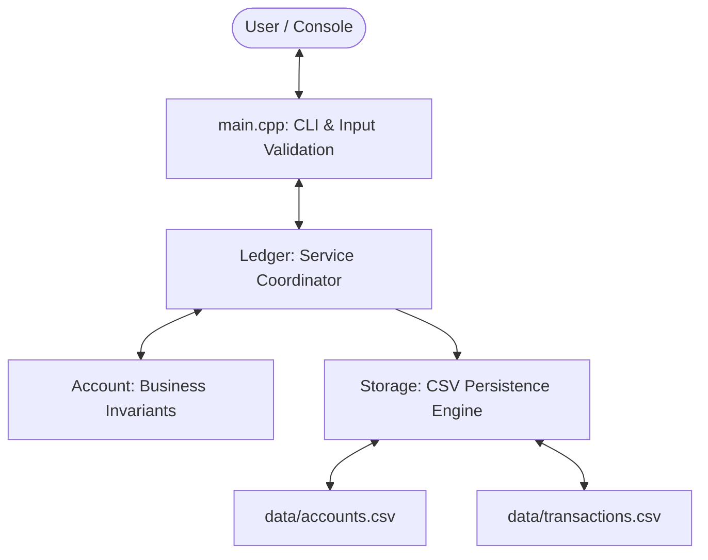

# 💳 Transaction Ledger System

A modular, crash-resilient financial transaction ledger implemented in modern C++. Designed with industry-standard practices including **fixed-point currency modeling**, **defensive overflow checks**, **append-only audit trails**, and **write-through CSV file persistence**.

---

## 🌟 Key Features

* **Fixed-Point Financial Modeling**: All monetary amounts are internally represented as exact integer units (`paise`, where `100 paise = Rs. 1.00`). This completely eliminates binary floating-point rounding errors common with `float` and `double`.
* **Defensive Systems Programming**: Prevents integer overflow before it happens by comparing values against `std::numeric_limits<Money>::max()` using boundary arithmetic.
* **Append-Only Audit Trail**: Every financial action (`Deposit`, `Withdrawal`) is logged with an immutable snapshot of the resulting balance, mirroring double-entry banking systems.
* **Write-Through Persistence**: Data is written directly to disk upon every transaction rather than only on exit. Abrupt terminal closures or crashes will never cause data loss.
* **Startup Hydration & Replay**: On boot, the system reloads all accounts, replays their historical transaction logs, and automatically synchronizes the next account ID (`max(id) + 1`).
* **Bulletproof Console I/O**: Stream state recovery via `cin.clear()` and `cin.ignore()` guarantees that invalid user inputs (such as text entered when numbers are expected) will not crash the application or cause infinite loops.
* **Clean Modular Architecture**: Adheres to the Single Responsibility Principle (SRP) with modular separation across domain models, business logic, storage engines, and user interfaces.

---

## 🏗️ Architecture & Module Breakdown

```
transaction-ledger/
├── data/
│   ├── .gitkeep               # Preserves data directory structure in Git
│   ├── accounts.csv           # Active account states (id, owner, balance)
│   └── transactions.csv       # Append-only transaction audit log
├── src/
│   ├── Account.h / .cpp       # Account model, invariant checks & history
│   ├── Storage.h / .cpp       # File I/O, CSV serialization & parsing
│   ├── Ledger.h / .cpp        # Aggregate root, account manager & persistence coordinator
│   └── main.cpp               # Interactive CLI menu & safe user input handling
├── .gitignore                 # Excludes build binaries, object files, and local CSVs
└── README.md                  # Project documentation
```

### Data Flow



| Component | Responsibility |
| :--- | :--- |
| [`Account`](file:///src/Account.h) | Holds account identity, balance, and transaction history. Enforces business invariants (positive amounts, non-negative balance, overflow guards). |
| [`Transaction`](file:///src/Account.h) | Immutable value object representing a historical event (`type`, `amount`, `balanceAfter`). |
| [`Ledger`](file:///src/Ledger.h) | Aggregate root managing the collection of accounts (`std::unordered_map`). Coordinates actions with `Storage`. |
| [`Storage`](file:///src/Storage.h) | Manages disk I/O using standard `<fstream>` and `<sstream>`. Handles automatic directory creation, file creation, CSV serialization, and error recovery. |
| [`main.cpp`](file:///src/main.cpp) | Presentation layer. Displays the menu loop, parses user inputs, and reports operation results. |

---

## 💾 Persistent Storage Schema

Data is preserved in the `data/` folder across application restarts:

### 1. `data/accounts.csv`
Maintains the current snapshot of all accounts:
```csv
id,owner,balance
1001,Alice Smith,50000
1002,Bob Jones,20000
```
*(Note: Balances are in paise. E.g., `50000` paise = Rs. `500.00`)*

### 2. `data/transactions.csv`
An immutable, append-only log of every financial transaction:
```csv
accountId,type,amount,balanceAfter
1001,Deposit,50000,50000
1002,Deposit,30000,30000
1002,Withdrawal,10000,20000
```

---

## 🚀 Getting Started

### Prerequisites
A C++ compiler supporting **C++14** or later (such as GCC/MinGW, Clang, or MSVC). No third-party libraries or dependencies are required.

### 🔨 Compilation

#### On Windows (PowerShell / Command Prompt with MinGW GCC):
```powershell
g++ -std=c++14 src/Account.cpp src/Storage.cpp src/Ledger.cpp src/main.cpp -o src/main.exe
```

#### On Linux / macOS (GCC / Clang):
```bash
g++ -std=c++14 src/Account.cpp src/Storage.cpp src/Ledger.cpp src/main.cpp -o src/main
```

---

### ▶️ Running the Application

#### Windows:
```powershell
.\src\main.exe
```

#### Linux / macOS:
```bash
./src/main
```

---

## 📖 Usage Walkthrough

Upon launching the application, you are presented with the interactive menu:

```text
=== Transaction Ledger ===
1. Create account
2. Deposit
3. Withdraw
4. Check balance
5. View transaction history
0. Exit
```

### Example Session

1. **Create Account**:
   - Select option `1`.
   - Enter name: `Alice Smith`.
   - The system generates unique ID: `1001`.
2. **Deposit Funds**:
   - Select option `2`.
   - Enter Account ID: `1001`.
   - Enter amount in rupees: `500`.
   - System confirms: `Transaction successful. Balance: Rs. 500.00`.
3. **Withdraw Funds**:
   - Select option `3`.
   - Enter Account ID: `1001`.
   - Enter amount: `150`.
   - System confirms: `Transaction successful. Balance: Rs. 350.00`.
4. **View Audit History**:
   - Select option `5`.
   - Enter Account ID: `1001`.
   - Output:
     ```text
     Transaction history for Alice Smith:
     Deposit    | Rs. 500.00 | Balance after: Rs. 500.00
     Withdrawal | Rs. 150.00 | Balance after: Rs. 350.00
     ```
5. **Verify Persistence**:
   - Exit the application with `0`.
   - Reopen `.\src\main.exe`.
   - Select option `4` or `5` for Account `1001`. All balances and history remain completely intact!

---

## 🧠 Technical Concepts Demonstrated

* **Fixed-Point Arithmetic**: Why `float` and `double` are unsafe for financial applications (IEEE-754 precision issues) and how integer scaling solves this.
* **Overflow Protection**: Checking `amount > std::numeric_limits<Money>::max() - balance` to avoid signed integer undefined behavior.
* **C++ Memory & Reference Semantics**: Using `const std::string&` and `const Transaction&` in loops and parameters to avoid unnecessary deep copying.
* **Modern Type Aliases**: Using `using Money = long long;` for expressive domain intent.
* **Stream State Machine**: Handling `std::cin.fail()`, clearing error bits with `std::cin.clear()`, and flushing remaining input via `std::cin.ignore()`.
* **Dynamic Memory & Pointers**: Non-owning pointer return semantics (`Account*`) with explicit `nullptr` checks.

---

<!-- ## 🔮 Future Enhancements

* [ ] Add multi-currency support with dynamic exchange rates.
* [ ] Add inter-account money transfer transactions (`Account A -> Account B`).
* [ ] Integrate ISO-8601 timestamps for each transaction using `<chrono>`.
* [ ] Add thread safety using `std::mutex` for concurrent transaction processing. -->
